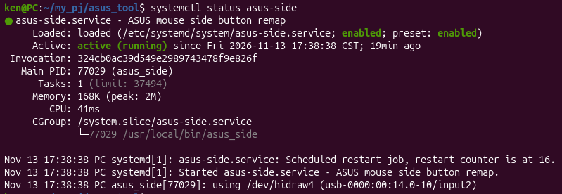

# ASUS ROG GLADIUS III CORE 側鍵 Linux 客製化(hidraw → uinput)

在 Linux 上,**ASUSTeK ROG GLADIUS III CORE** 滑鼠的側鍵沒有官方支援,現有工具也抓不到。本專案記錄從「抓不到側鍵」到「userspace 小程式重新對應側鍵」的完整研究過程,並附上可直接使用的程式碼。

<!-- 如有滑鼠實機照片,放到 images/mouse.jpg 後取消下一行註解

-->

## 目標

| 按鍵 | 目標行為 |
|---|---|
| 側上鍵 | 貼上 (Ctrl+V) |
| 側下鍵 | 複製 (Ctrl+C) |

需求:背景常駐、最輕量、延遲最低。

## 結論摘要

- **不需要寫 kernel driver。** `/dev/hidrawN` 已提供 raw HID report 給 userspace 讀取,寫 userspace 程式就足夠。
- 此滑鼠的側鍵走 **vendor-specific report(Report ID 0x03)**,不走標準滑鼠 report,所以一般 evdev 工具看不到。
- 最終方案:C 語言阻塞式 `read(hidraw)` → `write(uinput)` 注入鍵盤事件,由 systemd 常駐。
- **實測成功**:側上鍵貼上、側下鍵複製皆正常。

## 實測結果

systemd 常駐狀態(自動偵測版本,執行約 19 分鐘後):



| 項目 | 數值 |
|---|---|
| 常駐記憶體 | 168 KB(peak 2 MB) |
| CPU 累計時間 | 41 ms(約 19 分鐘內,含啟動掃描與實際操作) |
| 任務數 | 1 |

### 拔插與換插孔測試

滑鼠拔除期間程式找不到裝置,service 每 2 秒重啟重試;滑鼠插回後自動找回裝置,不需人工介入。

| 情境 | 程式輸出 |
|---|---|
| 初次啟動 | `using /dev/hidraw4 (usb-0000:00:14.0-4/input2)` |
| 拔除滑鼠 | `ROG GLADIUS III CORE (interface 02) not found`(持續重試,restart counter 累積至 16 仍未被停止) |
| 插回同一插孔 | `using /dev/hidraw4 (usb-0000:00:14.0-4/input2)` |
| 換到另一個 USB 插孔 | `using /dev/hidraw4 (usb-0000:00:14.0-10/input2)` |

換插孔後 HID_PHYS 的 USB 路徑由 `-4` 變成 `-10`,但程式只比對結尾的 `/input2`,不受插孔影響,仍能找到裝置。

> 以上測試中 hidraw 編號都剛好維持 `hidraw4`,尚未實際觀察到編號改變的情形;自動偵測的邏輯不依賴編號,理論上編號變動也能處理。

## 架構

```
ROG GLADIUS III CORE ──USB──> /dev/hidrawN ──read()──> asus_side ──write()──> /dev/uinput ──> 虛擬鍵盤 asus-side-btn ──> 桌面/應用程式
                                                        (解析 report)
```

## 環境

- 滑鼠:ASUSTeK ROG GLADIUS III CORE(VID `0b05`,ASUS)
- 介面:`/dev/hidraw4`
- OS:Linux(systemd)
- 工具:gcc、hexdump、evtest

## 研究過程

### 1. 找到對的 interface

ASUS 滑鼠通常會開多個 HID interface。用下列指令確認:

```bash
cat /sys/class/hidraw/hidraw4/device/uevent
sudo evtest                     # 確認標準 input 層看不到側鍵
sudo hexdump -C /dev/hidraw4    # 直接看 raw report
```

hidraw4 在按側鍵時有輸出,代表側鍵在這個 interface。

### 2. Report 格式分析

`hexdump` 會把連續 report 串在一起。`03` 開頭的 report 出現在 offset 0x00、0x15、0x2A、0x3F…,間隔固定 0x15,所以**每個 report 固定 21 bytes**,`read()` 一次回傳一個 report。

Report ID `0x03` 格式:

```
byte: 0   1   2   3   4   5     6..20
      03  12  01  00  00  MASK  00...
```

`byte[5]` 為 bitmask:

| byte[5] | 意義 | 型態 |
|---|---|---|
| 0x01 | 左鍵 | level(放開回 0x00) |
| 0x02 | 右鍵 | level |
| 0x04 | 中鍵 | level |
| 0x08 | **側下鍵** | level |
| 0x10 | **側上鍵** | level |
| 0x40 | 滾輪向上 | pulse(無放開事件) |
| 0x80 | 滾輪向下 | pulse |
| 0x00 | 全部放開 | |

要點:
- 按鍵為 level 型態,需與上一次狀態比較才能找出「按下」邊緣。
- 滾輪為 pulse 型態,每個 report 算一次 tick。
- 程式只取 `byte[5] & 0x1F`,排除滾輪 bit。
- 另有 Report ID `0x04` 的 report(`04 01 00 ...` / `04 00 00 ...`),用途**尚未確認**,本專案未使用。

### 3. 實作

核心流程(完整程式見 [`asus_side.c`](asus_side.c)):

1. 開啟 `/dev/hidrawN`(唯讀)與 `/dev/uinput`。
2. 建立虛擬鍵盤 `asus-side-btn`。
3. 迴圈阻塞 `read()`,比對前後狀態找出新按下的側鍵。
4. 用**單次 `write()`** 送出整組「Ctrl 按下 → 鍵按下 → SYN → 鍵放開 → Ctrl 放開 → SYN」,減少 syscall 次數。

選 C 而不是 Python 的理由:無 interpreter 啟動與執行開銷、阻塞讀取不需 polling、常駐記憶體僅數百 KB。

### 4. 組合鍵的選擇(遇到的問題)

| 版本 | 結果 |
|---|---|
| 上鍵 Ctrl+Shift+V、下鍵 Ctrl+Shift+C | 上鍵可貼上;**下鍵在一般應用程式無法複製** |
| 上鍵 Ctrl+V、下鍵 Ctrl+C(最終版) | **實測成功**,一般應用程式可正常貼上/複製 |

原因分析:Ctrl+Shift+C 只有終端機模擬器視為「複製」;在瀏覽器等程式是「檢查元素」或無作用。Ctrl+Shift+V 則恰好被許多程式當成「貼上純文字」,所以上鍵看起來正常。

**代價**:在終端機中,Ctrl+C 是 SIGINT(中斷正在執行的程式)。側下鍵在終端機按下會中斷前景程式,而不是複製。

替代方案(未採用):
- 下鍵 Ctrl+Insert、上鍵 Shift+Insert:在終端機與多數 GUI 程式都是複製/貼上,不必判斷視窗。
- 依焦點視窗切換組合鍵(X11 可用 xdotool,Wayland 較複雜):會增加延遲與複雜度。

## 安裝與使用

```bash
# 1. 編譯與安裝
gcc -O2 -o asus_side asus_side.c
sudo install -m 755 asus_side /usr/local/bin/

# 2. 安裝 service
sudo cp asus-side.service /etc/systemd/system/
sudo modprobe uinput
echo uinput | sudo tee /etc/modules-load.d/uinput.conf   # 開機自動載入
sudo systemctl daemon-reload
sudo systemctl enable --now asus-side

# 3. 檢查
systemctl status asus-side
journalctl -u asus-side -e
```

> 程式啟動時會自動掃描 `/dev/hidraw*`,依 VID/PID 與 interface 找出側鍵所在的裝置,不需手動指定 hidraw 編號。service 以 root 執行,因此不需另外處理 hidraw / uinput 權限。

### 裝置自動偵測

hidraw 編號會在重開機或重插後改變,所以程式不寫死路徑,啟動時掃描 `/dev/hidraw0~31`,同時符合以下條件的就是側鍵所在的裝置:

| 條件 | 值 | 取得方式 |
|---|---|---|
| VID | `0b05`(ASUS) | `HIDIOCGRAWINFO` |
| PID | `1c8d`(ROG GLADIUS III CORE) | `HIDIOCGRAWINFO` |
| HID_PHYS 結尾 | `/input2`(USB interface 02) | `HIDIOCGRAWPHYS` |

本機驗證:

```bash
$ cat /sys/class/hidraw/hidraw4/device/uevent
HID_ID=0003:00000B05:00001C8D
HID_NAME=ASUSTeK ROG GLADIUS III CORE
HID_PHYS=usb-0000:00:14.0-4/input2

$ cat /sys/class/hidraw/hidraw4/device/../bInterfaceNumber
02
```

這支滑鼠有多個 hidraw interface,VID/PID 相同,只有 interface 編號不同,所以必須加上 `/input2` 判斷。拔除滑鼠時 `read()` 失敗、程式離開,systemd 重啟後會重新掃描。service 設定 `StartLimitIntervalSec=0`,滑鼠不在時持續重試也不會被 systemd 停止。

也可手動指定裝置:`sudo ./asus_side /dev/hidraw4`。

### udev rule(選用)

若想要固定的 `/dev/asus_mouse` 路徑(給其他程式用),可安裝 `99-asus-mouse.rules`。本程式**不依賴**它。

```bash
sudo cp 99-asus-mouse.rules /etc/udev/rules.d/
sudo udevadm control --reload
sudo udevadm trigger
ls -l /dev/asus_mouse
```

> `udevadm info -a -n /dev/hidraw4` 輸出中 VID `1d6b` 的項目是 USB root hub,不是滑鼠,可忽略。

## 已知限制與待辦

- **原生側鍵事件可能重複觸發**:滑鼠的標準 input interface 可能仍會送出上一頁/下一頁(`BTN_SIDE`/`BTN_EXTRA`)。可用 `sudo evtest` 選滑鼠本體確認;若有,需對該 evdev 裝置使用 `EVIOCGRAB` 獨佔。本專案尚未實作。
- **Report ID 0x04** 的用途未確認。
- **bit5(0x20)** 未出現於測試 dump,可能對應其他按鍵(如 DPI 鍵),待確認。
- 拔除滑鼠時程式離開,由 systemd 每 2 秒重試並重新掃描裝置。裝置比對條件寫死為 ROG GLADIUS III CORE 的 VID/PID 與 interface 02。
- 僅在 ROG GLADIUS III CORE 上驗證;其他 ASUS 滑鼠的 report 格式可能不同。

## 檔案

| 檔案 | 說明 |
|---|---|
| `asus_side.c` | 主程式 |
| `asus-side.service` | systemd 常駐設定 |
| `99-asus-mouse.rules` | udev 固定 symlink(選用) |
| `images/` | README 用圖片 |

## 參考

- Linux HID raw 介面:`hidraw`
- Linux uinput:`linux/uinput.h`
- HID-BPF(kernel 6.3+),若日後需在 kernel 層修正 report descriptor
